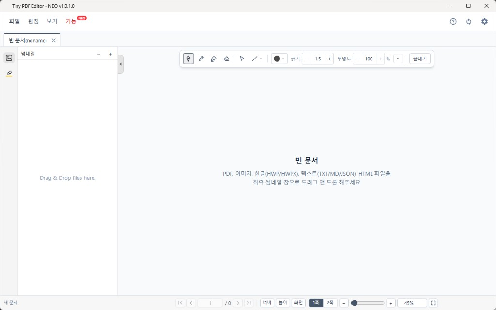
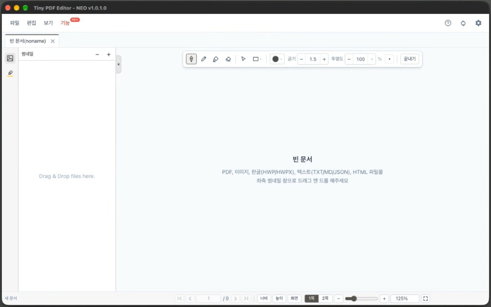

# Tiny PDF Editor - Neo

**Electron + React + Tailwind CSS로 재구성한 현대적 PDF 편집기**

Neo는 Tiny PDF Editor의 새로운 프론트엔드입니다. 메뉴, 썸네일, 본문, 대화상자를 Electron(데스크톱) + React 19 + Tailwind CSS 4로 새로 디자인했으며, PDF 편집 엔진은 Python 기반 `pdf_editor/engine.py`를 자식 프로세스로 사용합니다.

## 실행 화면

### Windows



### macOS



## 기술 스택

- **프론트엔드**: Electron, React 19, Tailwind CSS 4
- **백엔드 엔진**: Python 3, PyMuPDF (렌더링·편집·압축·레닥션·암호). 배포판에는 PyInstaller로 동결한 엔진이 들어 있어 사용자 PC에 Python이 필요 없습니다.
- **추가 기능**:
  - **OCR**: PP-OCRv5 ONNX (onnxruntime) — 인터넷 없이 로컬 추론
  - **개인정보 제거**: ko-pii — 한국어 개인정보 검출 및 레닥션
  - **형광펜/밑줄**: Excel 내보내기 (openpyxl)
  - **한글 변환** (Windows): 한컴 한글 COM (별도 설치 필요)
  - **가상 프린터** (Windows): Microsoft Print to PDF 기반. 인쇄하면 앱이 꺼져 있어도 Neo에서 열립니다. (macOS 흐름은 아직 이식되지 않았습니다.)

---

## 개발자용: 소스에서 실행

### 환경 준비

**Python 3.10+ 및 가상환경** (권장: Python 3.12)

```bash
python3.12 -m venv .venv
source .venv/bin/activate   # Windows: .venv\Scripts\activate
pip install -r requirements.txt
```

**Node.js** (Neo 개발 서버 및 빌드용)

```bash
npm install
```

### Neo 화면 실행 (독립형)

이 저장소만으로 Neo 화면을 단독 실행할 수 있습니다. Python 편집 엔진을 자동으로 찾아 사용합니다.

```bash
npm run neo:install   # 최초 1회 (neo-app 의존성 설치)
npm run neo           # 실행 (Electron 창 + 개발 서버 @3021)
npm run neo:restart   # 중지 후 재기동
npm run neo:stop      # 정리 후 종료
```

**작동 원리**:
- `neo-app/main.js` — Electron 메인 프로세스
- `neo-app/src/` — React 컴포넌트 (Vite 개발 서버)
- `pdf_editor/engine.py` — PDF 편집 엔진 (자식 프로세스)
- 엔진 경로는 `neo-app`에서 상위 2단계 (`../..`) 자동 감지
- Python 감지: PyMuPDF가 설치된 64비트 Python 자동 찾기 (또는 `TINY_PDF_PYTHON` 환경 변수)

---

## 주요 기능

### 파일 · 탭

- **새 문서** (`Ctrl+N`): 빈 탭 생성
- **최근 파일 열기**: 최근 파일 목록에서 선택
- **열기** (`Ctrl+O`): PDF, 이미지, (Windows) HWP/HWPX 열기. 여러 파일 선택 시 순서대로 병합
- **추가**: 현재 문서 끝에 PDF, 이미지, (Windows) HWP/HWPX 추가
- **저장** (`Ctrl+S`) / **다른 이름으로 저장** (`Ctrl+Shift+S`)
- **이미지로 저장**: 해상도(72~600 DPI), 형식(PNG/JPEG), 페이지 범위, 주석 포함 옵션
- **인쇄** (`Ctrl+P`): 앱 안의 인쇄 창 — 왼쪽에 설정(프린터, 쪽 범위, 매수·한 부씩, 컬러/흑백, 양면, 용지·방향, 한 장에 2/4/6/9쪽 모으기, 크기 맞춤·실제 크기·사용자 지정 %, 여백), 오른쪽에 **미리보기**(설정을 바꾸면 바로 반영, 장 넘기기). 미리보기와 인쇄물은 같은 배치 계산(`neo-app/shared/printLayout.js`)을 쓰므로 보이는 그대로 인쇄됩니다. 쪽은 300dpi(장수가 많으면 200/150dpi)로 그려 Chromium 이 프린터로 보내며 추가 프로그램은 들어가지 않습니다. 프린터 속성이 필요하면 "Windows 인쇄 창 열기"를 켭니다.
- **PDF 파일 연결** (Windows): 이 프로그램을 PDF 기본 열기 프로그램으로 등록/해제
- **가상 프린터**: 다른 프로그램에서 인쇄한 결과를 PDF로 받아 열기
- **탭**: 여러 PDF 동시 열기. 닫을 때 저장 여부 확인

### 편집

- **되돌리기** / **재실행** (`Ctrl+Z`, `Ctrl+Y`)
- **복사** / **잘라내기** / **붙여넣기** (`Ctrl+C`, `Ctrl+X`, `Ctrl+V`)
- **선택 페이지 삭제** (`Delete`)
- **모두 시계방향 회전** / **모두 반시계방향 회전**
- **텍스트 검색** (`Ctrl+F`, `F3` / `Shift+F3`)
- **텍스트 덮어쓰기**: 한 줄 더블클릭으로 인라인 편집

### 기능 메뉴

- **용량 줄이기**: PDF 이미지 압축 (해상도, 품질, 샘플링)
- **쪽 번호 매기기**: 위치, 스타일(1·i·I), 접두사/접미사, 글자 크기/색상, 여백
- **그리기**: 쪽 위에 직접 그리기(펜·연필·형광펜, 색·굵기·불투명도, 획 지우개). PDF 잉크 주석으로 저장되며 되돌리기 가능, Esc 로 끝내기
- **도형 그리기** (그리기 도구 막대의 도형 단추, 목록이 열려 있을 때 표시된 글자 키로 선택): 선(L) · 화살표(A) · 직사각형(R) · 타원형(V) · 다각형(P) · 클라우드(O) · 폴리라인(E) · 텍스트 상자(T). 끌어서 그리고(Shift 로 45° 각도·정사각형), 다각형·클라우드·폴리라인은 점을 눌러 Enter·두 번 누르기로 끝냅니다(Esc 취소, Backspace 마지막 점 지우기). 선·채우기 색, 굵기, 투명도, 점선, 텍스트 상자의 글자 색·크기를 고를 수 있습니다. **선택** 도구로 도형을 눌러 옮기고, 손잡이로 크기·꼭짓점을 바꾸고, 도구 막대에서 모양을 바꾸고, Delete 로 지웁니다(텍스트 상자는 두 번 눌러 글 고치기). **표준 PDF 주석**(Line/Square/Circle/Polygon/PolyLine/FreeText)으로 저장돼 저장·다시 열기 뒤에도 다시 고칠 수 있고 다른 뷰어에서도 그대로 보임·인쇄됨
- **이미지 넣기·다루기** (기능 메뉴, 이미지 파일을 쪽 위로 끌어다 놓아도 됨): 클립보드/파일의 이미지를 올려 끌어서 옮기고 모서리로 크기(비율 유지, Alt=가운데 기준)를 조절. 넣은 이미지는 **표준 PDF 스탬프 주석**으로 저장돼 저장·다시 열기 뒤에도 클릭해서 **다시 고칠 수 있음**(원본 그림 보존, 다른 뷰어에서도 그대로 보임·인쇄됨)
  - 선택·이동: 클릭(Shift+클릭 여러 개, Ctrl+A 쪽 전체), 드래그, 방향키(Shift=10pt), 쪽 가장자리·가운데·다른 이미지에 자석 정렬(Ctrl=끄기)
  - 크기·위치: mm 숫자 입력, 쪽 너비/높이/안에 맞춤/원본/50%/200%, 정렬(왼쪽·가운데·오른쪽·위·아래), 잠금
  - 복사·잘라내기·붙여넣기·복제(Ctrl+C/X/V/D), 삭제(Delete), 다른 쪽에도 같은 자리에 넣기(범위/모든 쪽)
  - 모양: **배경색 투명**(허용 오차·부드럽게·스포이트), 투명도, 90° 회전·좌우/상하 뒤집기, 자르기, 밝기·대비·흑백, 본문 글 아래로 보내기·쪽 내용으로 굳히기(굳힌 뒤엔 이미지로 편집 불가)
  - Enter·바깥 클릭·완료로 확정, Esc 로 이번 편집 취소(PDF 는 확정 전까지 바뀌지 않음), 확정 한 번 = 되돌리기 한 단계
- **OCR** (현재/선택/전체): 스캔 PDF에 숨은 텍스트 레이어 추가
- **개인정보 제거**: 한국어 PII(주민번호, 전화, 계좌 등) 감지 및 레닥션
- **비밀번호 설정** / **비밀번호 제거**: PDF 암호 설정/해제
- **PDF로 변환하기** (기능 메뉴): PDF · 이미지 · 한글 파일을 모아 두 가지 방식으로 처리 (미리보기 지원)
  - **하나의 PDF로 병합**: 목록 순서대로 PDF 하나로 합침. PDF 와 이미지를 섞어도 됩니다 (암호 PDF 지원)
  - **개별 변환**: 이미지·한글 파일을 각각 PDF로 저장 (원본과 같은 폴더 또는 지정 폴더)
  - 한글(HWP/HWPX) 변환은 Windows + 한컴 한글 필요

### 보안

- **암호로 보호된 PDF 열기**: 열기 비밀번호 입력
- **개인정보 제거** (`보안` 메뉴): 검은 박스 또는 한글 라벨로 감춤
- **비밀번호 설정** / **비밀번호 제거**

### 썸네일 (왼쪽 패널)

- **다중 선택**: `Ctrl` + 클릭 또는 드래그
- **드래그 앤 드롭**: 페이지 순서 변경 또는 외부 PDF/이미지 삽입
- **회전** (시계/반시계)
- **복사** / **잘라내기** / **붙여넣기**
- **삭제** (`Delete`)
- **페이지 보내기**: 선택 페이지만 새 PDF로 저장
- **이미지로 저장**: 같은 옵션으로 PNG/JPEG 내보내기
- **선택/전체 페이지 인쇄** (우클릭): 같은 인쇄 창이 열리고 "선택한 쪽"이 미리 골라집니다
- **선택/전체 페이지 개인정보 제거** (우클릭)
- **OCR** (현재/선택/전체) (우클릭)
- **썸네일 크기 조절**: `+` / `-` 버튼
- **패널 접기**: 왼쪽 패널 숨기기

### 형광펜 · 밑줄 (왼쪽 하단 탭)

- **추가**: 본문에서 텍스트 선택 후 우클릭
- **목록**: 왼쪽 패널에서 항목 확인 및 위치 이동
- **삭제**: 목록에서 클릭 또는 `Delete`
- **Excel 내보내기**: 형광펜/밑줄 목록을 `.xlsx`로 저장

### 본문 보기 (오른쪽)

- **확대/축소**: 슬라이더 (최대 600%), `Ctrl` + 휠, 또는 `+` / `-` 버튼
- **보기 모드**:
  - 너비 맞추기
  - 높이 맞추기
  - 화면 맞추기 (기본값)
- **두 쪽씩 보기** (`Ctrl+2`)
- **전체 화면** (`F11`): 메뉴/패널 숨기기. `Esc` 또는 상단 종료 버튼으로 해제
- **페이지 이동**: 하단 버튼, 방향키, PageUp/PageDown, Ctrl+Shift+←/→
- **스크롤**: 연속 스크롤 지원 (다음 페이지 ↔ 이전 페이지)
- **텍스트 선택**: 드래그로 텍스트 선택 후 `Ctrl+C`로 복사
- **스크롤바**: 반투명 스크롤바로 긴 페이지 탐색
- **터미널 패널**: OCR·개인정보 제거·용량 줄이기 진행 로그
- **페이지 정보**: 가로 × 세로 cm, 임베드 이미지 DPI

---

## 지원 파일 형식

| 형식 | 열기 | 추가 | 병합 | 드롭 |
|------|------|------|------|------|
| PDF (`.pdf`) | ✓ | ✓ | ✓ | ✓ |
| PNG, JPEG, BMP, GIF, TIFF, WebP | ✓ | ✓ | ✓ (이미지 1장 = 1쪽) | ✓ |
| HWP/HWPX (`.hwp`, `.hwpx`) | ✓ (Windows only) | ✓ (Windows only) | ✓ (Windows only) | ✓ (Windows only) |

> **Windows HWP 변환**: 한컴 한글 2020/2022/2024 설치 필요

---

## 단축키 요약

| 동작 | 단축키 |
|------|--------|
| 새 문서 | `Ctrl+N` |
| 열기 | `Ctrl+O` |
| 저장 | `Ctrl+S` |
| 다른 이름으로 저장 | `Ctrl+Shift+S` |
| 인쇄 | `Ctrl+P` |
| 되돌리기 / 재실행 | `Ctrl+Z` / `Ctrl+Y` |
| 복사 / 잘라내기 / 붙여넣기 | `Ctrl+C` / `Ctrl+X` / `Ctrl+V` |
| 텍스트 검색 | `Ctrl+F` |
| 다음 / 이전 검색 결과 | `F3` / `Shift+F3` |
| 선택 페이지 삭제 | `Delete` |
| 두 쪽씩 보기 | `Ctrl+2` |
| 전체 화면 | `F11` |
| 이전 / 다음 페이지 | `←` / `→` |
| 첫 / 마지막 페이지 | `Ctrl+Shift+←` / `Ctrl+Shift+→` |
| 확대 | `Ctrl` + `+` |
| 축소 | `Ctrl` + `-` |

---

## 엔진 프로토콜 (개발자용)

Neo 화면은 `pdf_editor/engine.py`를 자식 프로세스로 띄워 통신합니다.

**시작**:
```bash
python -m pdf_editor.engine
```

**프로토콜**: JSON 한 줄 → 처리 → JSON 한 줄 응답 + 진행 로그

**주요 작업** (`op`):
- `open` — PDF 열기
- `render` — 페이지 렌더링 (PNG)
- `textSelect` — 텍스트 선택 영역 조회
- `markupAdd` — 형광펜/밑줄 추가
- `pageNumbers` — 쪽 번호 추가
- `pageNumberOptions` — 쪽 번호 옵션
- `exportImages` — 선택 페이지를 이미지로 저장
- `save` — 현재 문서 저장
- `ocr` — 텍스트 인식 (스캔 PDF)
- `reduce` — 용량 줄이기
- `piiRemove` — 개인정보 제거

---

## 설정 (사용자 옵션)

Neo 창 우측 상단 ⚙️ 버튼에서 다음을 설정할 수 있습니다:

- **테마**: 강조색 선택
- **시작**: 시작 시 업데이트 확인, Windows/macOS 로그인 시 자동 실행
- **종료**: 창을 닫을 때 트레이로 최소화 (Windows)

설정은 `~/.tiny-pdf-editor/settings.json`에 저장됩니다.

---

## 시스템 요구 사항

- **Windows**: Windows 10 이상 (64비트)
- **macOS**: macOS 12 이상, Apple Silicon (arm64)
- **Python**: PyMuPDF 설치된 64비트 Python 3.10+
- **한글 글꼴**: 텍스트 덮어쓰기·쪽 번호 매기기 시 필요 (Windows: 맑은 고딕, macOS: Apple SD Gothic Neo)

---

## 라이선스

본 프로젝트는 **GNU Affero General Public License v3.0 (AGPL-3.0)** 입니다. `LICENSE` 파일을 참고하세요.

---

## 관련 링크

- 원본 Tiny PDF Editor: https://github.com/soonpyopark/Tiny-PDF-Editor
- 개발자 블로그: https://note4all.tistory.com
